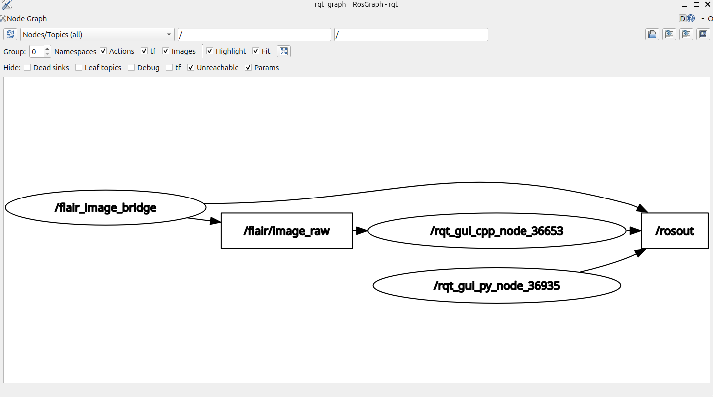

# Streaming FLAIR camera images to ROS2

**Demo:** `CircleFollower` (simulated `x4`, vertical camera)
**Audience:** anyone who already has a working FLAIR install and can run the
simulated `CircleFollower` demo (drone circling a VRPN-tracked target).

**Goal:** stream the drone's vertical camera to ROS2 as a
`sensor_msgs/Image` topic, with no loss and no desync, so it can be
consumed by any ROS2 node (optical flow, visual odometry, ...).

If you have never run `CircleFollower` before, do that first and confirm
`take_off` works before touching anything below. This tutorial only adds
image streaming on top of an already-working demo.

---

## 1. Overview

FLAIR does not talk to ROS2 directly. This integration adds:

- **FLAIR side**: a new `IODevice`, `ImageStreamer`, attached to the
  drone's vertical camera. Every time the camera produces a frame,
  `ImageStreamer` pushes it over a plain TCP socket.
- **ROS2 side**: a minimal Python node, `image_receiver_node`, that listens
  on that TCP socket, decodes the raw bytes, and republishes them as a
  standard `sensor_msgs/Image` on `/flair/image_raw`.

Wire protocol (intentionally minimal, no external dependency on either
side):

1. Once, right after the TCP connection opens: 8 bytes = `width` (uint32,
   little-endian) + `height` (uint32, little-endian).
2. Then, forever: one raw BGR frame per camera tick, `width * height * 3`
   bytes, row-major, no padding, no per-frame header.

For `CircleFollower`'s simulated vertical camera (`core2-64`/`x4`), that is
**320x240, BGR (3 bytes/pixel)**. If you stream a different demo/camera,
the width/height are read at runtime from the camera object, so nothing
else needs to change on the FLAIR side; only note it if you hand-decode
the raw stream yourself instead of using the provided ROS2 node.

> **Note:** only the image is sent. No velocity, no pose, no timestamp
> correlation with VRPN, by design, per the project's current
> requirements. If you need synchronized VRPN ground truth later, that is
> a separate addition, not covered here.

---

## 2. FLAIR side: add the `ImageStreamer` device

### 2.1 Copy the files

All paths below are relative to `$FLAIR_ROOT/flair-src`.

Copy these two **new** files into `demos/CircleFollower/uav/src/`:

- `ImageStreamer.h`
- `ImageStreamer.cpp`

Replace these **existing** files (they only add the `-s/--streaming` CLI
option and the `ImageStreamer` creation):

- `demos/CircleFollower/uav/src/CircleFollower.h`
- `demos/CircleFollower/uav/src/CircleFollower.cpp`
- `demos/CircleFollower/uav/src/main.cpp`
- `demos/CircleFollower/uav/CMakeLists.txt`

All 6 files are provided in the accompanying `flair_side/` folder: copy
them as-is, do not retype them.

### 2.2 Build **and install**

```bash
cd $FLAIR_ROOT/flair-src
flairmake all
```

> **This step is critical and easy to miss:** `flairmake all` only
> rebuilds the binaries under `flair-build/`. `flairrun` does **not**
> execute those; it executes the ones under `flair-install/`, which are
> only refreshed by `make install`. If you skip this, `flairrun` silently
> keeps launching the previous binary and none of your changes take
> effect (no compile error, no crash; it just behaves like nothing
> changed). Always run both:

```bash
cd $FLAIR_ROOT/flair-build/build_core2_64
make install
```

You should see a mix of `-- Installing:` and `-- Up-to-date:` lines. No
errors expected.

### 2.3 Sanity-check the installed binary (optional but recommended)

```bash
strings $FLAIR_ROOT/flair-install/bin/demos/core2-64/CircleFollower/CircleFollower_nrt \
  | grep -i "ImageStreamer: connected\|no vertical camera found"
```

Both strings should be present. If this prints nothing, `make install`
did not run, or ran against a different build directory; go back to 2.2.

---

## 3. ROS2 side: the image receiver node

A ready-to-build ROS2 package, `flair_image_bridge`, is provided in
`ros2_side/`.

### 3.1 Build it

```bash
cp -r ros2_side/flair_image_bridge ~/ros2_ws/src/
cd ~/ros2_ws
colcon build --packages-select flair_image_bridge
source install/setup.bash
```

Required dependencies (already present on a standard ROS2 desktop
install): `rclpy`, `sensor_msgs`, `cv_bridge`, `python3-numpy`.

> **Note:** if `ros2 run` fails with
> `ModuleNotFoundError: No module named 'rclpy._rclpy_pybind11'`, a conda
> `base` environment is shadowing the system Python that ROS2's `rclpy`
> was built against. Run `conda deactivate` in that terminal (or
> `conda config --set auto_activate_base false` to fix it permanently),
> open a fresh terminal, and re-source `~/ros2_ws/install/setup.bash`.

---

## 4. Running the demo end-to-end

The ROS2 node must be listening **before** FLAIR is launched: the
`ImageStreamer` constructor blocks on `Connect()` until something is
listening on the target port, so if you start FLAIR first it will simply
hang (silently) at that point in its startup, delaying `take_off`
readiness.

**Terminal 1: start the ROS2 receiver first:**

```bash
ros2 run flair_image_bridge image_receiver_node
```

Expected output: `listening for FLAIR on TCP port 5005, publishing on
"flair/image_raw"` then `waiting for FLAIR to connect...`.

**Terminal 2: launch the simulated demo as usual, then the drone:**

```bash
flairrun CircleFollower
```

This is the exact same command as before, no extra flags needed. The
`-s` (streaming target IP) CLI option added to `main.cpp` defaults to
`127.0.0.1`, i.e. FLAIR and ROS2 on the same machine. Only pass
`-s <ros2_machine_ip>` (edit the `x4.sh` launch script) if ROS2 runs on a
different machine.

**In FlairGCS:** `take_off` as usual.

At this point, Terminal 1 should print
`FLAIR connected from ('127.0.0.1', <port>)`.

---

## 5. Verifying the images

```bash
ros2 topic hz /flair/image_raw
```

Expect a steady rate (≈60 Hz for the simulated vertical camera).

To actually look at the stream:

```bash
ros2 run rqt_image_view rqt_image_view
```

> **Important:** the topic dropdown (top-left) starts **empty** even
> though the topic is publishing. Click the small circular **refresh**
> icon next to it first; only then does `/flair/image_raw` appear in the
> dropdown. Selecting it before that refresh is not possible; the plain
> grey gradient shown before you select anything is just rqt's
> placeholder pattern, not an error.

If you see the simulated environment's textured floor (rocks, in the
default `CircleFollower` scene) moving as the drone flies its circle, the
pipeline is working correctly end-to-end.

You can also cross-check against FLAIR's own simulator window (the
"active cam" view in the `simulator` window) to confirm both views show
the same content.

### Node graph

For reference, `rqt_graph` on a working setup looks like this:



`/flair_image_bridge` publishes `/flair/image_raw`, consumed here by
`rqt_image_view` (`/rqt_gui_cpp_node_*` / `/rqt_gui_py_node_*`).


---

## 6. Reusing the images

The topic is a standard `sensor_msgs/Image` (`bgr8` encoding); any ROS2
node can subscribe to it. Minimal consumer skeleton:

```python
import rclpy
from rclpy.node import Node
from sensor_msgs.msg import Image
from cv_bridge import CvBridge

class MyConsumer(Node):
    def __init__(self):
        super().__init__('my_consumer')
        self.bridge = CvBridge()
        self.create_subscription(Image, '/flair/image_raw', self.on_image, 10)

    def on_image(self, msg: Image):
        frame = self.bridge.imgmsg_to_cv2(msg, desired_encoding='bgr8')
        # frame is a standard OpenCV BGR ndarray (H, W, 3), process it here
```

Concrete use cases (optical flow algorithms, comparison bench, etc.) are
covered separately, on top of this base pipeline.

---

## 7. Use cases (demos)

Two consumer nodes are included in `flair_image_bridge`, both optional;
the base pipeline (§§1-5) works whether or not they are running.

### 7.1 Dense optical flow

```bash
ros2 run flair_image_bridge optical_flow_demo_node
ros2 run rqt_image_view rqt_image_view   # select /flair/optical_flow_view
```

Runs Farneback dense optical flow and draws the motion vectors as arrows
over the real image, published on `/flair/optical_flow_view`. At 60 Hz,
frame-to-frame displacement is often sub-pixel, too close to the
estimator's noise floor to visualize directly, so the node compares
frames a few steps apart (`frame_stride` parameter) and drops arrows below
`min_magnitude`. This is a demo/validation node, not a benchmark: it shows
the streamed images are directly usable by a standard OpenCV flow
algorithm, with no extra preprocessing.

### 7.2 Dataset recording

```bash
ros2 run flair_image_bridge dataset_recorder_node
```

Saves every incoming frame as a PNG plus a `manifest.csv` (index,
timestamp, filename) under `~/flair_datasets/run_<date>/`. Directly
serves the project's need for benchmark datasets; a VRPN ground-truth
column can be added to the manifest later, since it is not part of the
current image stream (see the note in §1).

---

## 8. Credit

Alessandra Elisa Sindi Morando (PhD student, Heudiasyc) had already
written a FLAIR → ROS1 image sender/receiver (`uav_camera_sender` /
`uav_camera_receiver`) for a different setup. That code was not reused
directly here; this integration targets ROS2 natively instead of going
through a ROS1↔ROS2 bridge, and the protocol below is a new, minimal
implementation written from scratch in Python/C++.

What was reused from her work, as a reference:

- The general idea of a raw TCP stream carrying a small fixed header
  (image dimensions) followed by raw pixel frames, with no extra framing.
- Including `<Camera.h>` explicitly in the FLAIR-side C++ file that
  upcasts a `Camera*` to `IODevice*`; her `Streaming.cpp` already did
  this, which is what pointed to the fix for the same compile error
  encountered here (see §6, "no matching function for call to
  ImageStreamer::ImageStreamer").
